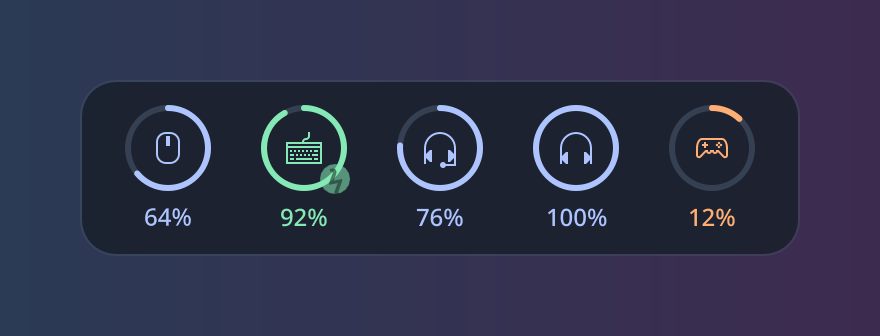
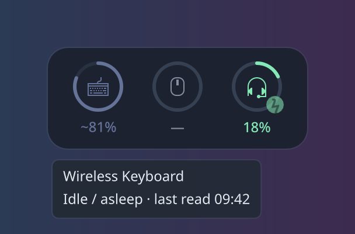

# ChargeCheck

A small KDE Plasma 6 desktop widget that shows the battery of your wireless
mouse, keyboard, headset, earbuds and controllers in one strip.



- **Finds devices on its own.** No configuration and no hard-coded device list.
- **Shows charging state.** A pulsing bolt appears while charging, the ring turns orange at 20%, and you get a notification at 15%.
- **Doesn't drain what it measures.** Keyboards that have to be queried over the air are only asked while you are typing. When they are idle the last reading is shown dimmed instead of waking them up.
- **Read-only.** It never changes a device setting.



## Where the numbers come from

| Source | Covers |
| --- | --- |
| Kernel `power_supply` | Most 2.4 GHz and USB mice, keyboards and game controllers |
| BlueZ | Connected Bluetooth earbuds, headphones, mice and keyboards |
| [HeadsetControl](https://github.com/Sapd/HeadsetControl) | USB and 2.4 GHz gaming headsets |
| [Arctis Sound Manager](https://github.com/loteran/Arctis-Sound-Manager) | Headsets it manages, used instead of HeadsetControl when it is running |
| Receiver query | 2.4 GHz keyboard receivers that don't report a battery to the kernel |

The device type and icon come from the device's input capabilities, not from a list of known models.

## Install

```sh
sudo pacman -S python-dbus libnotify headsetcontrol   # headsetcontrol is optional
git clone https://github.com/Denkiyaa/chargecheck
cd chargecheck
./install.sh
```

Then right-click the desktop, choose **Enter Edit Mode → Add Widgets…**, and add **ChargeCheck**.
To update later, run `git pull && ./install.sh`.

On other distributions, install the same packages: Python 3 with `dbus-python`, and `notify-send`.

### 2.4 GHz keyboard receivers (optional)

Some keyboard receivers don't report a battery to the kernel and have to be asked directly.
To allow that, run:

```sh
sudo ./setup-keyboard-access.sh
```

This only opens the receiver's control interface, not its typing interface. To notice when you are
typing, the widget also needs read access to the keyboard's input events, which members of the
`input` group have. Without it, the widget queries every 15 minutes instead.

Receivers that answer this query are listed by USB ID in `KNOWN` in
`package/contents/bin/receiver.py` and in the udev rule. If yours works, add its ID to both.

## Development

```sh
python -m unittest discover -s tests   # tests use fake sysfs trees, no hardware needed
/usr/lib/qt6/bin/qmllint package/contents/ui/*.qml
python3 package/contents/bin/chargecheck.py   # print what the widget sees
tools/screenshots.sh                   # regenerate the images above (sample data)
```

Built and tested on CachyOS with KDE Plasma 6, using a 2.4 GHz mouse and keyboard, a wireless
headset and Bluetooth earbuds. Reports from other hardware are welcome.

## License

GPL-3.0-or-later
